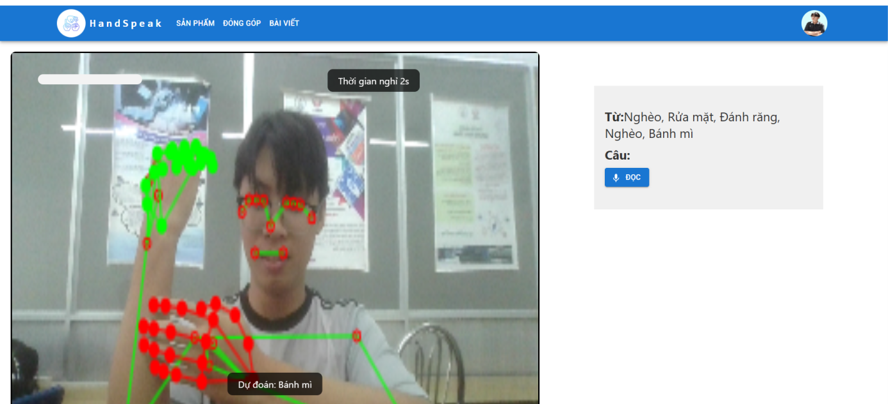
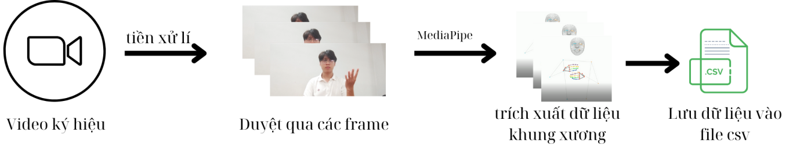
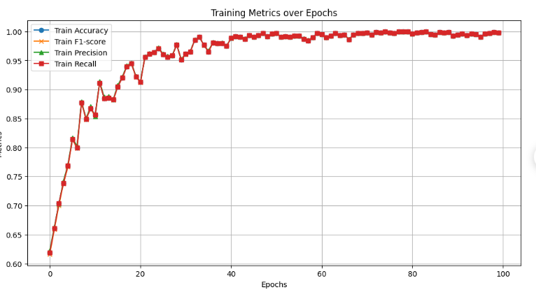

# Vietnamese Sign Language Recognition (SLR) Project

A comprehensive Sign Language Recognition system using LSTM and ST-GCN (Spatial Temporal Graph Convolutional Network) models for Vietnamese sign language recognition.

## 📋 Table of Contents

- [Overview](#overview)
- [Project Structure](#project-structure)
- [Features](#features)
- [Technology Stack](#technology-stack)
- [Prerequisites](#prerequisites)
- [Installation](#installation)
- [Usage](#usage)
- [Demo](#demo)
- [Results](#results)
- [Docker Deployment](#docker-deployment)
- [CI/CD](#cicd)
- [API Documentation](#api-documentation)
- [Contributing](#contributing)
- [License](#license)

## 🎯 Overview

This project implements a real-time Vietnamese Sign Language Recognition system that can recognize sign language gestures using computer vision and deep learning models. The system consists of:

- **Frontend**: React-based web application with MediaPipe for real-time hand and pose detection
- **Backend**: FastAPI server with ST-GCN and LSTM models for sign language prediction
- **Models**: Pre-trained ST-GCN and LSTM models for gesture classification

## ✨ Features

- **Real-time Sign Language Recognition**: Process video streams in real-time
- **Multiple Model Support**: ST-GCN and LSTM models for gesture classification
- **Web-based Interface**: User-friendly React frontend
- **RESTful API**: FastAPI backend with comprehensive endpoints
- **Docker Support**: Easy deployment with Docker and Docker Compose
- **CI/CD Pipeline**: Automated testing and deployment with GitLab CI/CD

## 🛠 Technology Stack

### Frontend
- React 18.3.1
- MediaPipe (Holistic, Camera Utils, Drawing Utils)
- Axios for API communication
- React Scripts

### Backend
- FastAPI 0.110.2
- PyTorch (for model inference)
- Uvicorn (ASGI server)
- Python 3.7+

### Machine Learning
- TensorFlow 2.16.1
- PyTorch
- ST-GCN (Spatial Temporal Graph Convolutional Network)
- LSTM with Attention mechanism

## 📦 Prerequisites

- **Python**: >= 3.7
- **Node.js**: >= 14.x
- **npm**: >= 6.x
- **Docker**: >= 20.x (optional, for containerized deployment)
- **Docker Compose**: >= 2.x (optional)

## 🚀 Demo

The following demo shows the real-time sign language recognition system in action. The web application captures video from the camera, extracts hand and pose landmarks using MediaPipe, and sends them to the backend for prediction using our trained ST-GCN model.

*Real-time sign language recognition interface showing camera feed with detected landmarks and predicted sign language gestures.*

## 📊 Results

### System Pipeline

The following diagram illustrates the complete pipeline of our sign language recognition system, from input video to final prediction:

*System architecture showing the flow from video input through MediaPipe landmark extraction, data preprocessing, and model inference to final prediction output.*

### Model Evaluation

The evaluation results demonstrate the performance of our ST-GCN and LSTM models on the Vietnamese sign language dataset:

*Performance metrics including accuracy, precision, recall, and F1-score for different sign language classes and overall model performance.*

## 🤝 Contributing

1. Fork the repository
2. Create your feature branch (`git checkout -b feature/AmazingFeature`)
3. Commit your changes (`git commit -m 'Add some AmazingFeature'`)
4. Push to the branch (`git push origin feature/AmazingFeature`)
5. Open a Pull Request

## 📝 License

This project is licensed under the MIT License - see the LICENSE file for details.

## 👥 Authors

- UTE-K21 Team

## 🙏 Acknowledgments

- MediaPipe team for the holistic solution
- FastAPI for the excellent web framework
- PyTorch and TensorFlow communities

## References

[1] B. Yu, H. Yin, and Z. Zhu, "Spatio-Temporal Graph Convolutional Networks: A Deep Learning Framework for Traffic Forecasting," Jul. 12, 2018.  
[2] S. Yan, Y. Xiong, and D. Lin, "Spatial Temporal Graph Convolutional Networks for Skeleton-Based Action Recognition," Jan. 25, 2018.  
[3] A. Núñez-Marcos, O. Perez-de-Viñaspre, and G. Labaka, "A survey on Sign Language machine translation," Expert Systems with Applications, vol. 213, no. 118993, 2023.  
[4] J. Bora, S. Dehingia, A. Boruah, A. A. Chetia, and D. Gogoi, "Real-time Assamese Sign Language Recognition using MediaPipe and Deep Learning," Procedia Computer Science, vol. 218, pp. 1384–1393, 2023.  
[5] R.-H. Liang and M. Ouhyoung, "A Real-time Continuous Gesture Recognition System for Sign Language," in Proc. IEEE Int. Conf. on Automatic Face and Gesture Recognition, Japan, 1998, pp. 558–567.  
[6] A. Arnab, M. Dehghani, G. Heigold, C. Sun, M. Lucic, and C. Schmid, "ViViT: A Video Vision Transformer," Nov. 1, 2021.  
[7] A. Moryossef, Z. Jiang, M. Müller, S. Ebling, and Y. Goldberg, "Linguistically Motivated Sign Language Segmentation," Findings of the Association for Computational Linguistics: EMNLP 2023, pp. 12703–12724, Dec. 6–10, 2023.  
[8] P. Das, S. Shekkizhar, and A. Ortega, "Towards a geometric understanding of Spatio Temporal Graph Convolution Networks," Dec. 12, 2023.  
[9] D. G. Lowe, "Distinctive Image Features from Scale-Invariant Keypoints," Computer Science Department, University of British Columbia, Vancouver, B.C., Canada, Jan. 5, 2004.  
[10] S. R. Eddy, "What is a hidden Markov model?," Nature Biotechnology, vol. 22, no. 10, pp. 1315–1317, Oct. 2004.  
[11] O. Koller, J. Forster, and H. Ney, "Continuous Sign Language Recognition: Towards Large Vocabulary Statistical Recognition Systems Handling Multiple Signers," Human Language Technology and Pattern Recognition, RWTH Aachen University, Germany, Dec. 13, 2015.  
[12] S. Patra, K. Kumaran, A. Maitra, S. Prabhu, M. Tiwari, S. Punyeshwarananda, and S. Samanta, "Hierarchical Windowed Graph Attention Network and a Large Scale Dataset for Isolated Indian Sign Language Recognition," Sep. 27, 2024.  
[13] C. Si, W. Chen, W. Wang, L. Wang, and T. Tan, "An Attention Enhanced Graph Convolutional LSTM Network for Skeleton-Based Action Recognition," Mar. 29, 2019.  
[14] TS. Vuong Hong Tam, "Expressive Features of Vietnamese Deaf Sign Language," Dec, 2011.  
[15] F. A. Gers, J. Schmidhuber, and F. Cummins, "Learning to Forget: Continual Prediction with LSTM," Artificial Neural Networks, 7-10 Sep. 1999, Conf. Publication No. 470, IEE, pp. 850-855, 1999.  
[16] J. Brownlee, "Long Short-Term Memory Networks With Python: Develop Sequence Prediction Models With Deep Learning," 2017.  
[17] K. Smagulova and A. P. James, "A survey on LSTM memristive neural network architectures and applications," Eur. Phys. J. Special Topics, vol. 228, pp. 2313-2324, 2019.  
[18] dxli94, "WLASL: A large-scale dataset for Word-Level American Sign Language," 2020.  
[19] A. Moryossef, "Optimizing Hand Region Detection in MediaPipe Holistic Full-Body Pose Estimation to Improve Accuracy and Avoid Downstream Errors," 2024.  
[20] "Sign Language Recognition," Papers with Code. [Accessed: Oct. 11, 2024].  
[21] Y. Sijie, "st-gcn." [Accessed: Nov. 5, 2024].  
[22] P. Santemiz, O. Aran, M. Saraclar, and L. Akarun, "Automatic sign segmentation from continuous signing via multiple sequence alignment," Computer Vision Workshops (ICCV Workshops), 2009 IEEE 12th International Conference, Nov. 2009.  
[23] "Sign, Translate," GitHub, 2024. [Accessed: Sep. 29, 2024].  
[24] A. Vaswani, N. Shazeer, N. Parmar, J. Uszkoreit, L. Jones, A. N. Gomez, Ł. Kaiser, and I. Polosukhin, "Attention is all you need," 31st Conference on Neural Information Processing Systems (NIPS 2017), Long Beach, CA, USA, 2017, Aug. 2, 2020.  
[25] A. Krizhevsky, I. Sutskever, and G. E. Hinton, "ImageNet classification with deep convolutional neural networks," Advances in Neural Information Processing Systems 25 (NIPS 2012), 2012, pp. 1097–1105.  
[26] W. S. McCulloch and W. Pitts, "A logical calculus of the ideas immanent in nervous activity," Bulletin of Mathematical Biophysics, vol. 5, no. 4, pp. 115–133, 1943.  
[27] G. E. Hinton, S. Osindero, and Y. W. Teh, "A fast learning algorithm for deep belief nets," Neural Computation, vol. 18, no. 7, pp. 1527–1554, 2006.  
[28] V. Piuri, S. Raj, A. Genovese, and R. Srivastava, "Trends in Deep Learning Methodologies: Algorithms, Applications, and Systems." Academic Press, 2021.